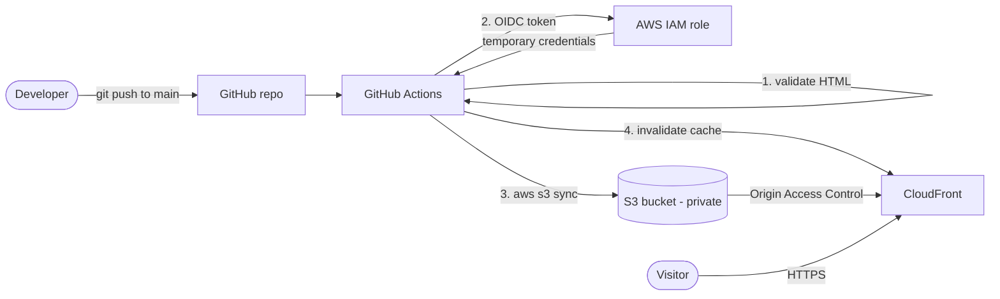

<div align="center">

# 🔧 Intech Motors: Website on AWS with CI/CD

**A real website and an offline billing app for a car workshop in Mylapore, Chennai.**
Hosted on AWS S3 + CloudFront and deployed automatically from GitHub with no stored credentials.

[](https://d166dz9n7bj9t4.cloudfront.net)


</div>

<!-- ADD SCREENSHOTS: save images in docs/ and un-comment these lines


-->

## ✨ What it does

**Public website**
- Gold-and-black responsive design, swipeable workshop gallery, animated hero
- **Instant estimate tool:** customers pick services and download a PDF estimate (generated in the browser, nothing sent to a server)
- Input validation: name, 10-digit mobile number, vehicle number, KMs, character limits
- Booking form that opens a pre-filled WhatsApp message

**Owner billing app (PWA, offline)**
- Installable on the owner's phone, works with no internet
- PIN lock, invoice numbering, GST and discount, PDF invoices in the shop's bill format
- Invoice history, search, and backup / restore. All data stays on the phone

## 🏗️ Architecture



## 🔐 Security decisions

| Decision | Why |
|---|---|
| **OIDC instead of AWS access keys** | GitHub gets short-lived credentials per run. No long-term keys in the repo or in secrets |
| **Role limited to one repo and the `main` branch** | A fork or another branch cannot deploy |
| **Private S3 bucket + CloudFront Origin Access Control** | Only CloudFront can read the files; the bucket is never public |
| **Least-privilege IAM policy** | Can only list, put and delete in this bucket and invalidate this distribution |
| **`.gitignore` for `*.csv` + GitHub push protection** | An accidental access-key file was blocked by GitHub secret scanning before it reached the repo |
| **Owner app data stays on the device** | No customer data is stored on any server |

## 🧩 Challenges and how I solved them

| Problem | Cause | Fix |
|---|---|---|
| CloudFormation failed on the CloudFront distribution | New AWS accounts must be verified for CloudFront | Opened an AWS Support case; approved, then redeployed |
| `Not authorized to perform sts:AssumeRoleWithWebIdentity` | GitHub's OIDC `sub` claim now includes numeric IDs (`repo:owner@id/repo@id:ref:...`), so my trust policy did not match | Debugged by printing the token claims in a workflow, then allowed both claim formats in the role's trust policy |
| Push rejected by GitHub | A downloaded access-key CSV was inside the project folder | Removed it from the commit, rotated the key, added `*.csv` to `.gitignore` |
| Deploy silently stopped | The HTML check job failed after `index.html` was deleted | Restored the file; the pipeline's validate-before-deploy gate worked as designed |

## 🛠️ Tech stack

`AWS S3` · `CloudFront` · `IAM / OIDC` · `CloudFormation` · `GitHub Actions` · `HTML / CSS / JavaScript` · `jsPDF` · `Service Worker (PWA)` · `Cloudflare DNS`

## 📁 Project structure

```
├── index.html              public website
├── assets/                 css, js (estimate tool, validation), images
├── owner/                  offline billing PWA (not linked from the public site)
├── infra/template.yaml     CloudFormation: S3, CloudFront, IAM role
└── .github/workflows/      CI/CD pipeline
```

## 🚀 Deploy your own copy

1. Fork this repo and create the stack:
   ```bash
   aws cloudformation deploy --template-file infra/template.yaml \
     --stack-name my-site --capabilities CAPABILITY_IAM \
     --parameter-overrides GitHubRepo=YOUR-USER/YOUR-REPO
   ```
2. Put the stack outputs (role ARN, bucket, distribution ID) into `.github/workflows/deploy.yml`.
3. Push to `main` and the workflow publishes the site.

## 💰 Cost

Runs inside the AWS Free Tier / free-plan credits. CloudFront has an always-free monthly allowance, and a site this small uses a tiny part of it.

## 🗺️ Next improvements

- [ ] Rewrite the infrastructure in Terraform
- [ ] Add a free ACM certificate and a custom domain
- [ ] Security scanning in the pipeline (Checkov, Trivy)
- [ ] CloudWatch alarm for CloudFront errors

---
<sub>Built by [Subash V](https://github.com/subashvelu) for Intech Motors, Mylapore.</sub>
